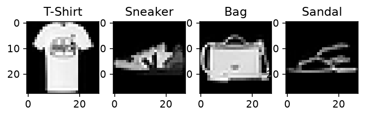

# NeuralNetworks
Einige Klassifizierungsprobleme, gelöst in TensorFlow.

## Fashion-MNIST
Bild Klassifizierung des Fashion-MNIST Datasets. 
 
 
Ein einfaches Convolutional Neural Network aus zwei Convolutional-Layern. Nach dem Training kann das Modell zwischen 10 verschiedenen Kategorien unterscheiden. Dabei wird eine Accuracy von knapp 89% erreicht.
